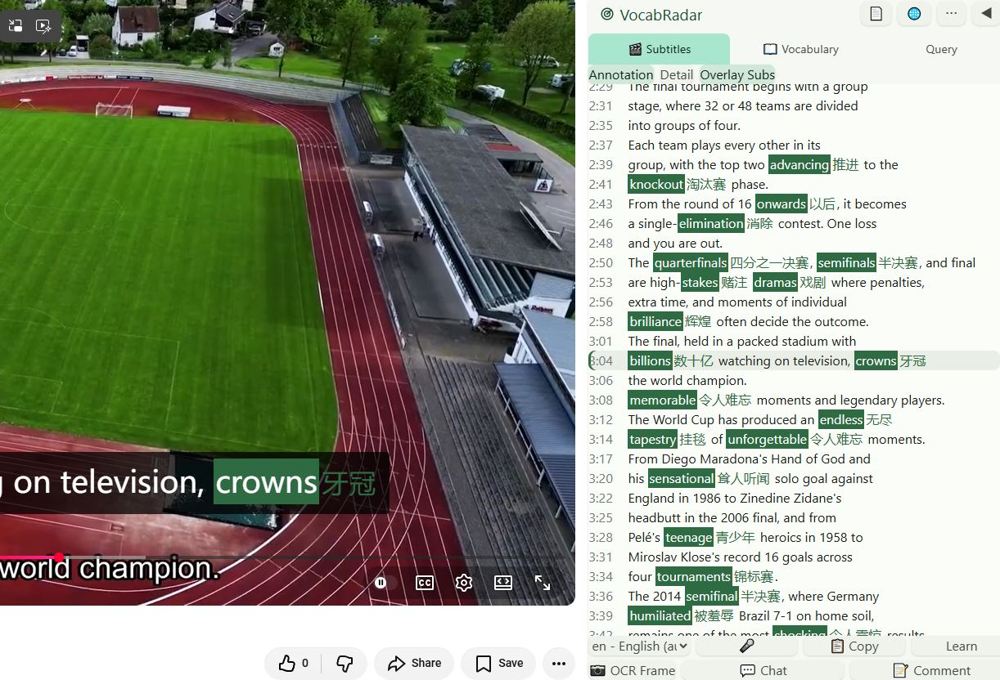
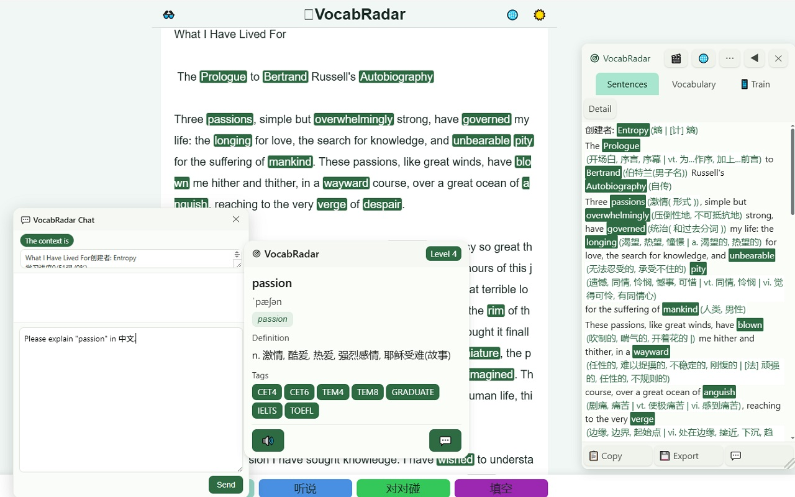

# VocabRadar 词汇雷达

发现并学习视频与网页中的生词。

**[English](README.md) | [简体中文](README-zh.md) | [Español](README.es.md) | [العربية](README.ar.md) | [Português (BR)](README.pt-BR.md) | [Bahasa Indonesia](README.id.md) | [Français](README.fr.md) | [日本語](README.ja.md) | [Русский](README.ru.md) | [Deutsch](README.de.md)**

配套网站：<https://vocabradar.com>

## 这是啥

VocabRadar 是 Chrome / Edge / Firefox 的浏览器扩展。它扫描你正在看的视频或网页，根据词频判断你可能不认识的词并标注释义。支持 **110 种语言**。免注册、无账号，所有查询在本地进行，浏览记录不上传。

支持的语言（110 种）：

`af am ar arz as ast az azb ba be bew bg bn bo bs ca ce ceb ckb cs cy da de dv el en eo es et eu fa fi fil fr fy ga gl gmh gu ha he hi hr hu hy id ig is it ja ka kk km kn ko ku ky la lb lo lt lv mg mk ml mn mr ms mt my nb ne new nl nn no nrm oc or pa pl pnb ps pt ro ru sd sh si sk sl so sq sr sv sw ta te tg th tr tt ug uk ur uz vi war yi zh`

## 能干些啥

- **看视频学词**——B 站 / YouTube 视频页右侧出现学习面板：字幕列表（生词高亮）+ 生词表。字幕也可叠加在视频画面上，带注释。注释可切详略，点击时间戳跳转到对应句子，一键填入评论框或弹幕。
  - **双语副行**——优先使用站上自带的第二语言字幕轨，并与主字幕做时间对齐；站上没有第二语言轨时才回退机器翻译。
- **逛网页学词**——任意网页正文的生词高亮显示，悬停查看释义，右键可查词；侧栏汇总本页生词与例句。
- **单词卡片**——悬浮、右键、侧栏内嵌三种卡片统一显示词阶、标签、释义，以及同族词汇和按语义相似度排序的**相关词汇**。
- **没字幕也能学**——装上可选的免费**本地配套程序**后，无字幕视频、录音、上传的音视频都在本机转写成可学文本（faster-whisper / Qwen3-ASR / MOSS / whisper.cpp，在配套程序里选引擎）；OCR 识别视频帧文字（硬字幕、幻灯片），走配套程序或你自己的 OpenAI / Anthropic 兼容 Key。不装配套程序，其余功能照常可用。
- **AI 对话**——内置对话窗，可用免费模型或你自己配置的 OpenAI / Anthropic 兼容 Key，结合上下文查词和讨论。
- **可选本地配套程序**——自己在本机跑的 Python 服务（`127.0.0.1:7777`）：本地 LLM 对话、语音转写、OCR、离线翻译（本地 Hy-MT2 / LMT-60 模型）与音视频/字幕下载。安装 `python backend/scripts/install.py`，启动 `python backend/app.py`。
- **配套练习与体验**——把整理的页面和卷轴推送到 [vocabradar.com](https://vocabradar.com)，进行复习与练习。

## 截图

视频提示（字幕+注释） | 网页生词提示
:---:|:---:
 | 

## 安装

| 浏览器 | 方法 |
|---|---|
| **Firefox** | [addons.mozilla.org — VocabRadar](https://addons.mozilla.org/zh-CN/firefox/addon/vocabradar/) |
| **Edge** | [Microsoft Edge 加载项 — VocabRadar](https://microsoftedge.microsoft.com/addons/detail/hcpmjphbnjhlfahimifbkhfjafkfjbbb) |
| **Chrome** | 尚未上架商店。请在 [Releases](https://github.com/laohur/VocabRadar/releases) 页面下载最新 zip，解压后打开 `chrome://extensions`，开启**开发者模式**，点击**加载已解压的扩展程序**，选择解压出的文件夹。官方指南：[加载已解压的扩展程序](https://developer.chrome.com/docs/extensions/get-started/tutorial/hello-world?load-unpacked)。 |

## 微信小程序

想在手机上练习？用微信扫描下方二维码，打开「河狸记词」小程序：

## 数据来源

- **词频数据**——来自 Hugging Face 数据集
  [`vocabradar/VocabFreq`](https://huggingface.co/datasets/vocabradar/VocabFreq)：上述各语言的自建词频表（语料取自 FineWeb2-HQ+ / UltraFineWeb-L3 / Wikipedia，700 个百分之一贝尔频段）。扩展按需下载你所学的语言，使用前校验完整性（SHA-256）。
- **英文词表与释义**——随扩展本地打包。
- **翻译包**——来自 Hugging Face 数据集
  [`vocabradar/WordTranslation`](https://huggingface.co/datasets/vocabradar/WordTranslation)：按语言对的 `{word, translations}` 词条包，按需下载并校验完整性；内置英中包作为离线兜底。
- **相关词汇**——来自 Hugging Face 数据集
  [`vocabradar/WordEmbedding`](https://huggingface.co/datasets/vocabradar/WordEmbedding)：int8 词向量，用于按语义相似度排序近邻词。近邻计算在本机完成，不上传任何内容。
- **翻译**——在线渠道、Chrome 内置 Translator API、你自己配置的 AI 接口，或可选的本地配套程序（本地 Hy-MT2 / LMT-60 模型，离线）；每次只发送你主动查询的文本。

## 隐私

无账号、无数据收集、无追踪。一切都在你的设备上。详见 [PRIVACY.md](PRIVACY.md)（中英双语）。

## 仓库 / 许可证

- 仓库地址：<https://github.com/laohur/VocabRadar>（其 Releases 页面用于提供 Chrome 安装包）。
- 许可证：*待填——占位。*
- 构建与 AMO 源码披露说明：[doc/build-readme.md](doc/build-readme.md)。